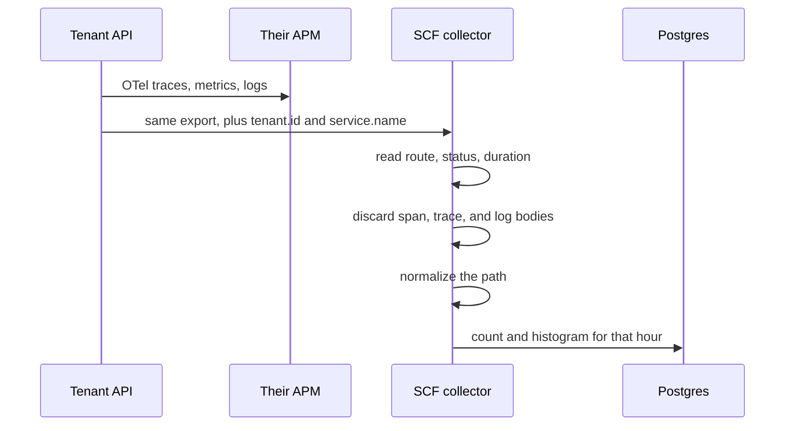

# API analytics

Tenants keep their own APM. They add our collector as a second OpenTelemetry export. We accept the full export, then throw away everything that is not a metric.

## Stored attributes

| Attribute | Use |
| --- | --- |
| `tenant.id` | Which project. Must match the enrolled project. |
| `service.name` | Which service inside that project. |
| `http.route` | Endpoint, after normalization. |
| `http.response.status_code` | Success vs error. |
| latency | p50 and p95 from a histogram. |

The normalizer is a fixed rule list in code. No tenant UI for custom rules. It rewrites numeric ids, UUIDs, hex hashes, Stellar `G…`, `C…`, and `M…` addresses, and trailing slashes to placeholders. A team that wants a cleaner name sets `http.route` in its own middleware.

Aggregates are kept **24 months**. Raw rows used for debugging are kept 14 days, then deleted. Tenant dashboard: volume, status mix, p50, p95, for a chosen range. SCF dashboard: the same numbers across projects, with sort, filter, and side-by-side comparison.
