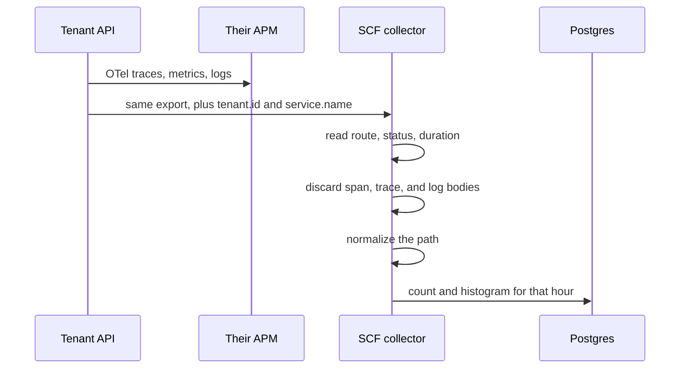

# API analytics

Tenants keep their own APM. They add our collector as a second OpenTelemetry export. We accept the full export, then throw away everything that is not a metric.



## Stored attributes

| Attribute | Use |
| --- | --- |
| `tenant.id` | Which project. Must match the enrolled project. |
| `service.name` | Which service inside that project. |
| `http.route` | Endpoint, after normalization. |
| `http.response.status_code` | Success vs error. |
| latency | p50 and p95 from a fixed histogram. |

The histogram buckets are fixed at 5, 10, 25, 50, 100, 250, 500, 1000, 2500, 5000, and 10000 ms. p50 and p95 are the ceiling of the bucket a call falls in, so a 40 ms call is reported as 50 ms.

The normalizer is a fixed rule list in code. No tenant UI for custom rules. It rewrites numeric ids, UUIDs, hex hashes, Stellar `G…`, `C…`, and `M…` addresses, and trailing slashes to placeholders. A team that wants a cleaner name sets `http.route` in its own middleware.

Aggregates are kept **24 months**. Raw rows used for debugging are kept 14 days, then deleted. Tenant dashboard: volume, status mix, p50, p95, for a chosen range. SCF dashboard: the same numbers across projects, with sort, filter, and side-by-side comparison.

## Integrate (POC)

The hosted POC collector accepts OTLP/HTTP JSON today. Prism already dual-exports this way. Other projects can do the same in about an hour on a typical Node or Next.js API.

**Endpoint:** `POST https://otlp-collector-production.up.railway.app/v1/traces`  
**Auth:** `Authorization: Bearer <tenant token>` (issued per project; ask the operator)

Set these on the **server / API** only — never in the browser:

```
PULSE_OTLP_ENDPOINT=https://otlp-collector-production.up.railway.app
PULSE_OTLP_TOKEN=<tenant token>
PULSE_TENANT_ID=<your tenant id>
PULSE_SERVICE_NAME=<your service name>
```

Each request should send one span with `tenant.id`, `service.name`, `http.route`, `http.response.status_code`, and start/end timestamps for latency. Fire-and-forget is fine; if the collector is down, the app stays up.

If you already run OpenTelemetry, add this collector as a **second** OTLP HTTP exporter with the bearer token. If you do not, drop in the small helper below and call it from your API handlers (same pattern Prism uses).

```ts
type PulseSpan = { route: string; statusCode: number; durationMs: number; method?: string };

function endpoint() {
  return process.env.PULSE_OTLP_ENDPOINT?.trim().replace(/\/+$/, "") || undefined;
}
function token() {
  return process.env.PULSE_OTLP_TOKEN?.trim() || undefined;
}
function tenantId() {
  return process.env.PULSE_TENANT_ID?.trim() || "TENANT_ID";
}
function serviceName() {
  return process.env.PULSE_SERVICE_NAME?.trim() || "api";
}
function attr(key: string, value: string | number) {
  return typeof value === "number"
    ? { key, value: { intValue: value } }
    : { key, value: { stringValue: value } };
}

/** Fire-and-forget. No-ops when env is unset. */
export function exportPulseApiSpan(span: PulseSpan): void {
  const url = endpoint();
  const auth = token();
  if (!url || !auth) return;

  const start = BigInt(Date.now() - Math.max(0, Math.round(span.durationMs))) * 1_000_000n;
  const end = start + BigInt(Math.max(0, Math.round(span.durationMs))) * 1_000_000n;

  void fetch(`${url}/v1/traces`, {
    method: "POST",
    headers: {
      "content-type": "application/json",
      authorization: `Bearer ${auth}`,
    },
    body: JSON.stringify({
      resourceSpans: [
        {
          resource: {
            attributes: [attr("tenant.id", tenantId()), attr("service.name", serviceName())],
          },
          scopeSpans: [
            {
              scope: { name: "pulse-otlp" },
              spans: [
                {
                  name: span.method ? `${span.method} ${span.route}` : span.route,
                  startTimeUnixNano: start.toString(),
                  endTimeUnixNano: end.toString(),
                  attributes: [
                    attr("http.route", span.route),
                    attr("http.response.status_code", span.statusCode),
                    ...(span.method ? [attr("http.method", span.method)] : []),
                  ],
                },
              ],
            },
          ],
        },
      ],
    }),
  }).catch(() => {});
}

// In each API handler:
const started = Date.now();
let status = 500;
try {
  // ... handle request ...
  status = response.status;
  return response;
} finally {
  exportPulseApiSpan({
    route: "/api/your-route",
    statusCode: status,
    durationMs: Date.now() - started,
    method: "GET",
  });
}
```

After a few live calls, the console API tab labels that project **Live** when the collector has rows for its `tenant.id`. Collector source: [scf-analytics-poc](https://github.com/HeylmStoned/scf-analytics-poc).
