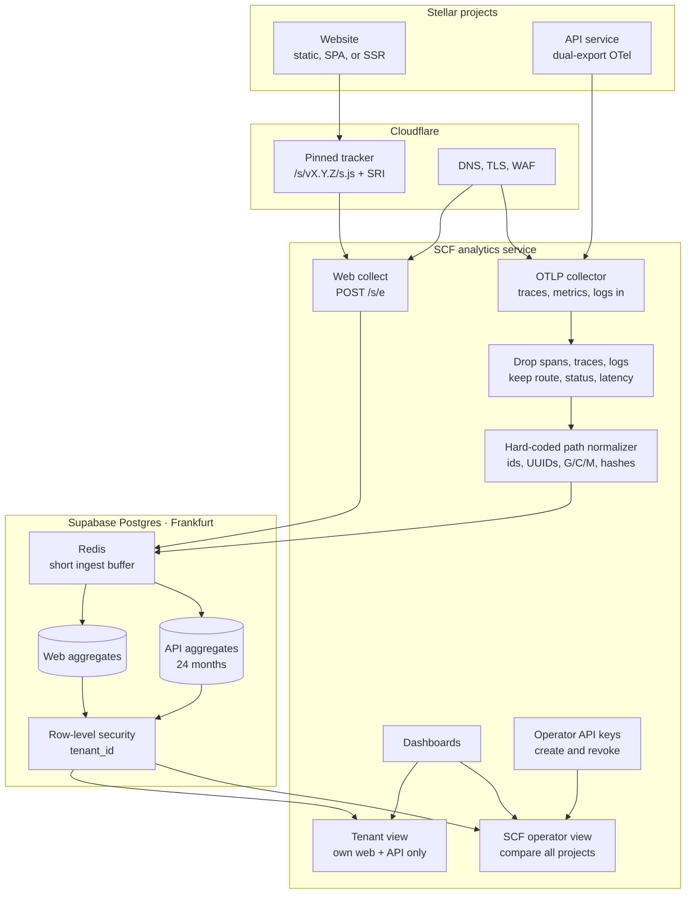

# System architecture

Shared, free, privacy-first analytics for Stellar projects. SCF operators get one comparable view of real usage.

Base product: **Umami** (MIT, TypeScript, Node.js, PostgreSQL). We fork it and add Stellar tenancy, an SCF operator view, and an OpenTelemetry metrics collector. GoatCounter is written in Go. It already records pageviews, referrers, browser, operating system, screen size, and country. It does not compute bounce rate or visit duration. Those two are required, and Umami already computes both.

A project adds one pinned script tag for the website, and points its existing OpenTelemetry exporter at our collector as a second destination. Nothing else changes in the app. We never store their traces.

## Components

| Component | Role | Base |
| --- | --- | --- |
| Tracker file | Versioned browser script on Cloudflare, pinned with SRI | Umami tracker, our endpoints |
| Collect API | Receives page events from the tracker | Umami, forked |
| OTLP collector | Accepts dual-export OTel; drops traces/spans/logs; writes metrics | New service |
| Path normalizer | Rewrites IDs, UUIDs, hashes, Stellar G/C/M addresses | Hard-coded module in the collector |
| Redis | Short ingest buffer next to Postgres (counters only). Ships in Docker Compose so a third-party operator can reinstall it from the repository | Redis |
| Dashboards | Tenant private view + SCF global compare view | Umami dashboard, extended |
| Database | Postgres with RLS per tenant in **Frankfurt (eu-central-1)** | Supabase |

Only the tracker file is served from Cloudflare’s CDN. Umami, the collector, Redis, and Postgres run as container services. Cloudflare serving the script does **not** mean the application runs on Cloudflare Workers.

## Web flow

1. The tenant site loads the pinned tracker file, checked against its SRI hash.
2. The tracker reads the page path and referrer, then posts one event to `POST /s/e`.
3. The collect API drops known bots and requires the registered origin and Sec-Fetch headers.
4. It derives the country, then discards the IP address.
5. Pageviews, referrer, device and browser are written under the tenant ID (via Redis buffer) into Postgres in Frankfurt.

## API flow

1. The tenant API dual-exports OpenTelemetry to its own APM and to our collector, with `tenant.id` and `service.name`.
2. The collector keeps method, normalized route, status code, and latency; drops traces, spans, and logs.
3. The path normalizer rewrites identifiers before storage.
4. Hourly counts and latency histograms land in Postgres via the same Redis buffer.

## Sizing

Design target: **1,000,000 API requests per day** across all tenants (~12 req/s average, sized for ~100 req/s peaks), validated by load tests before launch. Web traffic is smaller.

## Web analytics (summary)

Events come only from the browser script. Umami already computes pageviews, unique visitors, referrers, bounce rate, session duration, country, device, and browser. The fork keeps those definitions.

- Tracker: `/s/vX.Y.Z/s.js` + SRI; collect at `POST /s/e`; no cookies; daily-rotating visitor salt on truncated IP + UA.
- Bots: `isbot`, Origin + Sec-Fetch required, ignore body-supplied IP, same-IP fingerprint skepticism, rate limits. Headers can be forged — this stops careless inflation; it is not cryptographic proof of a human.
- Retention: raw events 14 days; daily aggregates 24 months; CSV export of aggregates in first delivery.

## API analytics (summary)

Tenants keep their APM and add our collector as a second OTLP destination. Stored: `tenant.id`, `service.name`, normalized `http.route`, status code, latency histograms (fixed ms buckets). Aggregates 24 months. Hard-coded normalizer (no tenant custom-rule UI).

## Tenants, isolation, and keys (summary)

- Enrollment with Stellar proof (`stellar.toml`, Soroban contract ID, or SCF project link).
- Data residency: **Frankfurt only** (see [Infrastructure](infrastructure.md) and [Privacy](privacy.md)).
- Postgres RLS on `tenant_id`. SCF operators are a separate global role. Operator API keys hashed, rotatable. Zero fees.

## Privacy (summary)

No cookies or browser storage. Truncated IP, country only, daily salt. Tenant-triggered erasure within 30 days. Germany checked explicitly before launch for any opt-in edge case. Full note: [Privacy and compliance](privacy.md).

## Operations (summary)

| Target | RFP | Our commitment |
| --- | --- | --- |
| Data collection (ingest) availability | 99.99% | **99.9%** — one-sentence reason: we will not commit above Supabase’s published platform uptime and a two-replica app tier without uncosted active-active failover |
| Dashboard availability | 99.90% | **99.9%** |
| Critical / high vulnerability remediation | 24 hours | **24 hours** |
| Support response / resolution | 5 / 10 business days | **5 / 10 business days** (public GitHub issues; no mandatory on-call) |

Full table and handover: [Operations and handover](operations.md).

## Plain-English stack

Umami (forked) serves the script, dashboards, and login. A small OTLP collector turns API telemetry into hourly metrics and deletes traces. Both write through Redis into Supabase Postgres in Frankfurt, with RLS per tenant. Cloudflare serves the pinned tracker and terminates TLS. Docker Compose is how the next operator rebuilds the system. Stellar appears in enrollment and path normalization — not as a place we write analytics.
