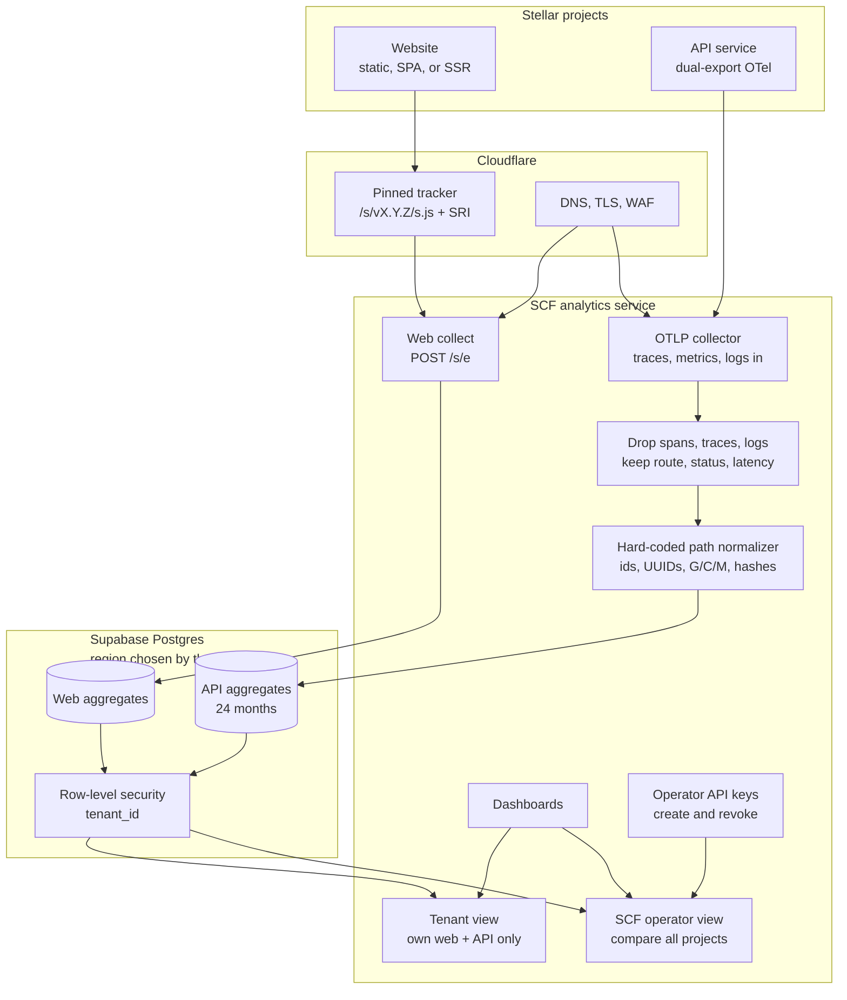

# System architecture

A project adds one pinned script tag for the website, and points its existing OpenTelemetry exporter at our collector as a second destination. Nothing else changes in the app. We never store their traces.
