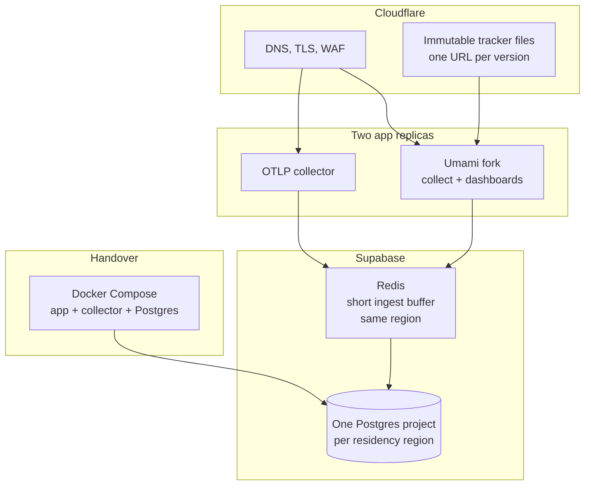

# Infrastructure

* **Tracker files** are static and versioned on Cloudflare. A release never changes a URL that tenants already embedded.
* **Umami and the collector** run as two stateless replicas. Umami is a Node server. The collector has to parse full OpenTelemetry payloads. The tracker file is the piece that stays on Cloudflare.
* **Postgres** is Supabase. A Supabase project is bound to one region. We run one Supabase project per residency option we offer (for example Frankfurt, London, Virginia). At enrollment the tenant chooses a region; every later read and write for that tenant goes only to that project. We do **not** replicate tenant analytics across regions. Edge routing (tenant → region → connection) is how Cloudflare Workers and the app pick the right database. More tenants do not mean more regions; regions stay fixed, and each regional database scales inside its region. Region choice is available on Pro and Team; the 99.9% uptime SLA is Enterprise.
* Umami does not ship row-level security. We add it, and every analytics read and write is bound to `tenant_id` inside that regional project.
* **Redis** only buffers a short burst between the collector and Postgres in the same region. It is not a system of record.
* **Docker Compose** in the same monorepo is how the next operator rebuilds the system. Terraform is included for the hosted setup. The compose file is the handover contract.
* Design load is about **1,000,000 API requests per day** (about 12 requests/second average, sized for 100/second peaks). Web traffic is smaller than that.
