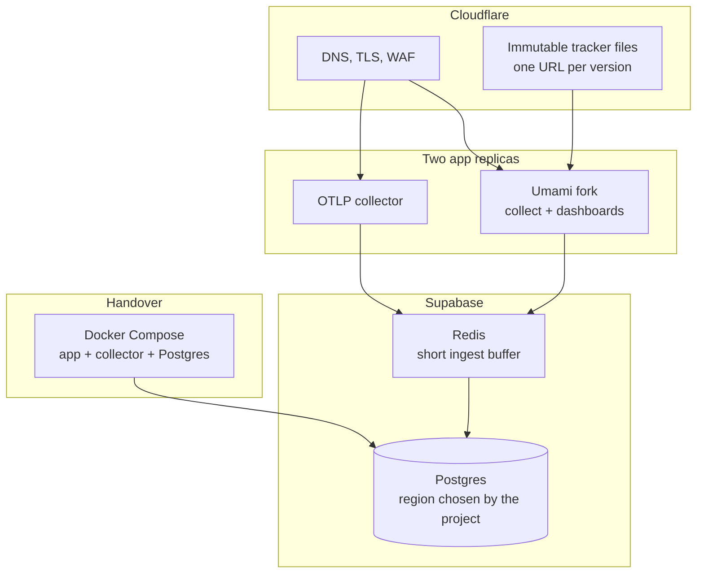

# Infrastructure

* **Tracker files** are static and versioned on Cloudflare. A release never changes a URL that tenants already embedded.
* **Umami and the collector** run as two stateless replicas. Umami is a Node server. The collector has to parse full OpenTelemetry payloads. The tracker file is the piece that stays on Cloudflare.
* **Postgres** is Supabase. Supabase offers all of their regions, and each project chooses where its analytics are stored. Umami does not ship row-level security. We add it, and every analytics read and write is bound to `tenant_id`.
* **Redis** only buffers a short burst between the collector and Postgres. It is not a system of record.
* **Docker Compose** in the same monorepo is how the next operator rebuilds the system. Terraform is included for the hosted setup. The compose file is the handover contract.
* Design load is about **1,000,000 API requests per day** (about 12 requests/second average, sized for 100/second peaks). Web traffic is smaller than that.
