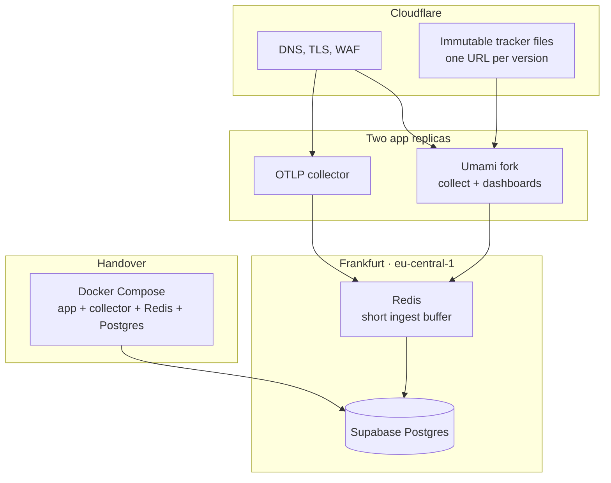

# Infrastructure

* **Tracker files** are static and versioned on Cloudflare. A release never changes a URL that tenants already embedded.
* **Umami and the collector** run as two stateless replicas. Umami is a Node server. The collector parses full OpenTelemetry payloads. The tracker file is the piece that stays on Cloudflare.
* **Data location:** analytics Postgres and Redis run in **Frankfurt (`eu-central-1`) only**. This matches the Interest Form commitment to EU data residency. We do not offer a US region and we do not ask tenants to pick among regions.
* **Redis** buffers a short burst between the collectors and Postgres. It holds counters only, never payload bodies. Redis is included in Docker Compose so a third-party operator can reinstall the full stack from the repository. We do **not** use Cloudflare Queues as the ingest buffer.
* Umami does not ship row-level security. We add it; every analytics read and write is bound to `tenant_id`.
* **Docker Compose** in the monorepo is how the next operator rebuilds the system. Terraform is included for the hosted setup. The compose file is the handover contract.
* Design load is about **1,000,000 API requests per day** (about 12 requests/second average, sized for 100/second peaks). Web traffic is smaller than that.
* The public console POC may run on Railway as a **UI prototype**. That is not production hosting; production follows this stack.
