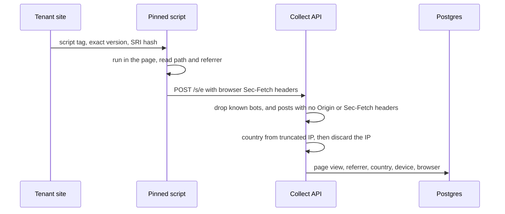

# Web analytics

Events come only from the browser script.



The snippet looks like this, and the version in the URL is the version that runs:

```html
<script
  defer
  src="https://s.example/s/v1.4.2/s.js"
  data-site="SITE_ID"
  integrity="sha384-..."
  crossorigin="anonymous"></script>
```

Umami already computes the required web metrics. We keep its definitions. Pageviews are pageview events, not custom events mixed in. Visitors are distinct sessions. A bounce is a visit with one event, divided by visits. Visit duration is the time from the first event to the last in a visit, and Umami only adds that time when the visit has more than one page. That is the session duration the RFP asks for. Referrer, country, device, and browser stay. Custom events stay available. Stellar Wallets Kit events are an optional add-on and are not on the critical path.

## Bots and inflated numbers

* Umami already drops known bot user agents through `isbot`. That check stays on.
* The visitor id is taken from the connection IP and the connection user agent. Stock Umami will accept an IP sent inside the JSON body. The fork ignores that field.
* A collect call also needs a registered `Origin` and browser `Sec-Fetch-*` headers. A plain server POST without those is dropped. The headers can be forged, so this stops careless inflation. It is not proof that our script ran.
* Many different visitor hashes from the same truncated IP in a short window do not each count as a unique visitor. They count as one, and the cluster is flagged. Pageviews are kept, with a cap per IP, so an office or a mobile network is not erased.
* The public names are `/s/vX.Y.Z/s.js` and `POST /s/e`. The script no longer uses the `umami` global or `/api/send`, which is what current blocker lists match.

## Supply chain

* Each release is an immutable file. Tenants upgrade only by changing the version in their own HTML.
* The tag carries a Subresource Integrity hash. A swapped file does not run.
* The script does not fetch remote config and does not change behavior after publish.
* Dependencies are lockfiled, audited on each release, and tagged in git.

## Unique visitors

Stock Umami hashes the full IP, the user agent, and the website id with a salt that rotates monthly. That salt is derived from the server secret, and rotating it does not delete it. The fork changes this. The hash uses the truncated IP, the user agent, and a random salt. That salt is deleted at the end of the UTC day, so the hash cannot be recomputed and the same person is not linked across days. The RFP allows that limit.
